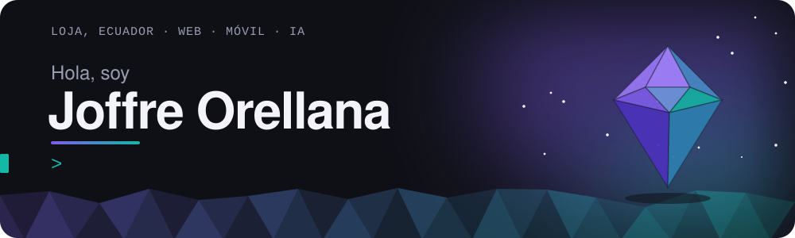

  

Ingeniero en Ciencias de la Computación (Universidad Nacional de Loja, 2026), itinerario de Sistemas Inteligentes. Desarrollo apps web y móviles, y modelos de visión por computadora. Cuido lo que pasa después de publicar: lógica crítica en el servidor, pruebas automáticas y respaldos que se verifican solos.

## Proyectos

<table>
  <tr>
    <td width="50%" valign="top">
      <b>AURA</b> <code>en Google Play</code> <code>freelance</code> 
      App de citas para el emprendimiento de un cliente. Likes, tokens y compras se validan en el servidor; cerré una falla que permitía conseguir tokens sin pagar. 
      <code>React Native</code> <code>Expo</code> <code>TypeScript</code> <code>Firebase</code> 
      <a href="https://play.google.com/store/apps/details?id=com.aurals.app">Google Play</a> · código privado
    </td>
    <td width="50%" valign="top">
      <b>Defectos en llantas</b> <code>tesis</code> <code>94,9 % de exactitud</code> 
      Transfer learning sobre VGG16 con 1 698 imágenes; Grad-CAM muestra en qué zona de la llanta decide el modelo. 
      <code>Python</code> <code>TensorFlow</code> <code>Keras</code> <code>OpenCV</code> 
      <a href="https://github.com/xJoffre/PIC">Código</a> · <a href="#tesis">Resultados</a>
    </td>
  </tr>
  <tr>
    <td valign="top">
      <b>El Mirador</b> <code>proyecto personal</code> 
      Pedidos en línea para un bar-restaurante: cocina en vivo por SSE, panel por rol y una CI que prueba migraciones, contrato OpenAPI, end-to-end y respaldos. 
      <code>Java 25</code> <code>Spring Boot 4</code> <code>PostgreSQL</code> <code>React 19</code> <code>Docker</code> 
      <a href="https://github.com/xJoffre/el-mirador">Código</a>
    </td>
    <td valign="top">
      <b>Jengat</b> <code>proyecto personal</code> <code>Android</code> 
      Juego de fiesta 3D: torre de 54 bloques con física real, retos propios y mundo low poly. 
      <code>Godot 4.6</code> <code>GDScript</code> 
      <a href="https://github.com/xJoffre/Jengat">Código</a> · <a href="https://github.com/xJoffre/Jengat/releases/latest">Descargar APK</a>
    </td>
  </tr>
</table>

## Tesis

Detección de defectos en llantas con transfer learning sobre VGG16. El modelo acierta 242 de 255 llantas de prueba y detecta 126 de las 130 defectuosas.

  

La matriz de confusión y los mapas de Grad-CAM están en el <a href="https://github.com/xJoffre/PIC#resultados">repositorio de la tesis</a>.

## Stack

## Contribuciones

<picture>
  <source media="(prefers-color-scheme: dark)" srcset="https://raw.githubusercontent.com/xJoffre/xJoffre/output/snake-dark.svg">
  
</picture>