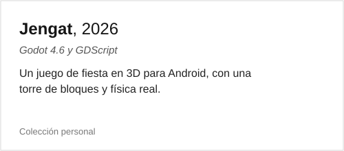
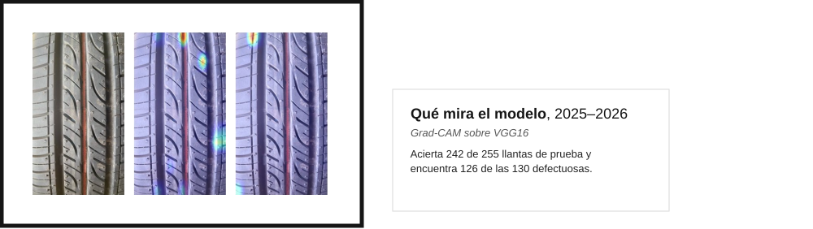

<picture><source media="(prefers-color-scheme: dark)" srcset="assets/banner-dark.svg"></picture>

## Proyectos

<a href="https://play.google.com/store/apps/details?id=com.aurals.app"><picture><source media="(prefers-color-scheme: dark)" srcset="assets/aura-dark.svg"></picture></a> <a href="https://github.com/xJoffre/PIC"><picture><source media="(prefers-color-scheme: dark)" srcset="assets/pic-dark.svg"></picture></a>

<a href="https://github.com/xJoffre/el-mirador"><picture><source media="(prefers-color-scheme: dark)" srcset="assets/el-mirador-dark.svg"></picture></a> <a href="https://github.com/xJoffre/Jengat"><picture><source media="(prefers-color-scheme: dark)" srcset="assets/jengat-dark.svg"></picture></a>

## Tesis

<a href="https://github.com/xJoffre/PIC#resultados"><picture><source media="(prefers-color-scheme: dark)" srcset="assets/thesis-dark.svg"></picture></a>

## Stack

<picture><source media="(prefers-color-scheme: dark)" srcset="assets/stack-dark.svg"></picture>

## Contribuciones

