<picture><source media="(prefers-color-scheme: dark)" srcset="assets/banner-dark.svg"></picture>

<a href="https://play.google.com/store/apps/details?id=com.aurals.app">AURA</a> · <a href="https://github.com/xJoffre/PIC">Defectos en llantas</a> · <a href="https://github.com/xJoffre/el-mirador">El Mirador</a> · <a href="https://github.com/xJoffre/Jengat">Jengat</a>

## Tesis

<a href="https://github.com/xJoffre/PIC#resultados"><picture><source media="(prefers-color-scheme: dark)" srcset="assets/thesis-dark.svg"></picture></a>

## Actividad

<picture><source media="(prefers-color-scheme: dark)" srcset="https://raw.githubusercontent.com/xJoffre/xJoffre/output/activity-dark.svg"></picture>
